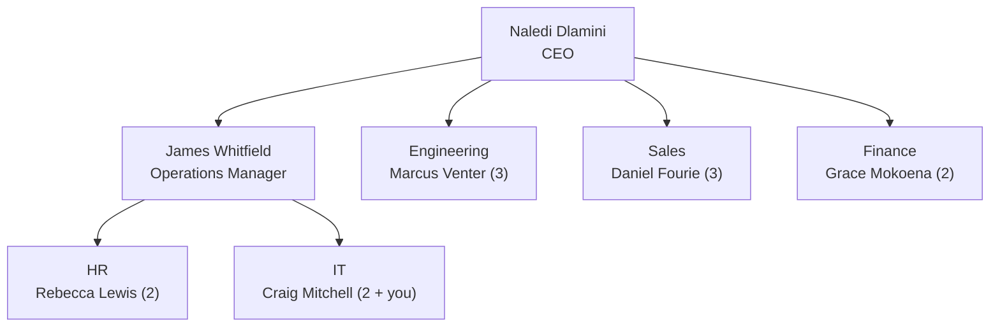

# ByteKelp Systems (Pty) Ltd: Company Profile

> **Fictional company.** ByteKelp Systems is an invented company created as the scenario for an IT support home lab. All names, roles, policies and data are made up. Any resemblance to real businesses or people is coincidental.

---

## 1. Company overview

| | |
|---|---|
| **Company** | ByteKelp Systems (Pty) Ltd |
| **Industry** | Software as a Service (SaaS) |
| **Product** | Cloud inventory software for independent retailers |
| **Founded** | 2020 |
| **Headquarters** | Cape Town, South Africa (one office) |
| **Staff** | 15 (14 employees plus the IT Support Technician) |
| **Domain** | `corp.internal` (NetBIOS name `CORP`) |
| **Slogan** | "Know what's on your shelves." |

### The story

ByteKelp started as a small project helping Cape Town shop owners keep track of their stock. It now has 15 people and a growing customer list, but its IT is informal: shared passwords, open folders and no helpdesk. The new **IT Support Technician** has been hired to put proper accounts, permissions and support processes in place.

---

## 2. Organisation chart



---

## 3. Departments

| Department | Staff | Head | What they do | OU / security group |
|---|---|---|---|---|
| Management | 2 | Naledi Dlamini | Run the company | Management / GG-Management |
| Engineering | 3 | Marcus Venter | Build the product | Engineering / GG-Engineering |
| Sales | 3 | Daniel Fourie | Win and look after customers | Sales / GG-Sales |
| Finance | 2 | Grace Mokoena | Invoicing, accounts and payroll | Finance / GG-Finance |
| HR | 2 | Rebecca Lewis | Hiring and people admin | HR / GG-HR |
| IT | 2 (+ you) | Craig Mitchell | Internal IT and support | IT / GG-IT |

---

## 4. Employee directory

Usernames follow the convention **first initial + surname**, in lowercase. The user principal name (UPN) is `username@corp.internal`.

| Name | Username | Title | Department |
|---|---|---|---|
| Naledi Dlamini | ndlamini | Chief Executive Officer | Management |
| James Whitfield | jwhitfield | Operations Manager | Management |
| Marcus Venter | mventer | Lead Developer | Engineering |
| Thandi Nkosi | tnkosi | Software Engineer | Engineering |
| Ravi Naidoo | rnaidoo | Software Engineer (works from home) | Engineering |
| Daniel Fourie | dfourie | Head of Sales | Sales |
| Priya Reddy | preddy | Account Executive | Sales |
| Tyler Jansen | tjansen | Sales Representative | Sales |
| Grace Mokoena | gmokoena | Finance Manager | Finance |
| Zoe Abrahams | zabrahams | Accounts and Payroll Clerk | Finance |
| Rebecca Lewis | rlewis | HR Manager | HR |
| Anika Roux | aroux | HR Administrator | HR |
| Craig Mitchell | cmitchell | IT Manager | IT |
| Ben Hughes | bhughes | Service Desk Analyst | IT |
| *You* | *your username* | IT Support Technician | IT |

Your two accounts: a normal **daily account** (in the IT OU) and a separate **admin account** named `adm-yourname` (member of Domain Admins), used only for administration.

### Coming soon

| Name | Username | Title | Start date |
|---|---|---|---|
| Imogen Cele | icele | Sales Representative | Next Monday (used for the new-starter exercise) |

---

## 5. IT environment

| Item | Detail |
|---|---|
| Network | LabNet `192.168.50.0/24` |
| Domain | `corp.internal` |
| Domain controller | DC01, `192.168.50.10` (Active Directory, DNS, DHCP, file server) |
| Helpdesk | TICKET01, `192.168.50.20` (osTicket), alias `helpdesk.corp.internal` |
| VPN | VPN01, `192.168.50.30` (WireGuard) |
| Staff workstation | CLIENT01 (Windows 11 Enterprise) |
| DHCP scope | `192.168.50.100` to `192.168.50.200` |

### Naming conventions

| Object | Convention | Example |
|---|---|---|
| Users | first initial + surname | `zabrahams` |
| Admin accounts | `adm-` + username | `adm-yourname` |
| Security groups (global) | `GG-` + department | `GG-Finance` |
| Permission groups (domain local) | `DL-` + resource + level | `DL-Finance-Modify` |
| Servers | role + number | `DC01`, `TICKET01` |

### File shares

| Share | Path | Who has access |
|---|---|---|
| HR | `\\DC01\HR` | HR only |
| Finance | `\\DC01\Finance` | Finance only |
| Sales | `\\DC01\Sales` | Sales only |
| Shared | `\\DC01\Shared` | All staff |

### Company IT rules

| Policy | Rule |
|---|---|
| Account lockout | Locked for 15 minutes after 3 failed sign-ins |
| Passwords | Complexity required; changed at first sign-in after an IT reset |
| Screen lock | Workstations lock after 15 minutes of inactivity |
| Admin accounts | IT staff use a separate admin account for administration |
| Access | Staff only get access to the folders their department needs |
| Leavers | Disable the account on the last day and move it to Disabled Users |

### Helpdesk service levels

| Priority | Example | Target response |
|---|---|---|
| High | One person cannot work at all | 4 business hours |
| Normal | Slow laptop, access request | 1 business day |
| Low | General question, minor request | 3 business days |

---

## 6. Processes

### New starter

1. HR raises a ticket with the person's name, role and department.
2. Create the user in the department OU.
3. Add the user to the department group (`GG-<department>`).
4. Check access to the right shares.
5. Prepare the workstation and join it to the domain.
6. Give the temporary password securely, set to change at first sign-in.
7. Close the ticket with a summary.

### Leaver

1. HR raises a ticket with the last working day.
2. Disable the account on that day.
3. Move it to the Disabled Users OU.
4. Remove it from all groups.
5. Record the actions in the ticket and close it.

---

## 7. Lab scenario cast

| Scenario | Person | Lab |
|---|---|---|
| Forgot password | Anika Roux | Active Directory |
| Account locked out | Tyler Jansen | Active Directory |
| Leaver: disable and move | Priya Reddy | Active Directory |
| New starter: create from scratch | Imogen Cele | Active Directory |
| "I can't open the Finance folder" | Zoe Abrahams | File shares |
| Wants to share a folder with a contractor | James Whitfield | File shares |
| Slow laptop | Thandi Nkosi | Hardware and OS |
| Websites will not load but Wi-Fi works | Daniel Fourie | DNS |
| No network after boot (169.254 address) | Rebecca Lewis | DHCP |
| Cannot connect to the VPN from home | Ravi Naidoo | VPN |

---

## 8. Build scripts (replace the earlier versions in the curriculum)

Run these on DC01 in an elevated PowerShell after promotion.

### 8.1 Organisational units

```powershell
$base = "DC=corp,DC=internal"
New-ADOrganizationalUnit -Name "Company" -Path $base
"Management","Engineering","Sales","Finance","HR","IT","Groups","Workstations","Disabled Users" | ForEach-Object {
    New-ADOrganizationalUnit -Name $_ -Path "OU=Company,$base"
}
```

### 8.2 Users from CSV

```powershell
New-Item -ItemType Directory -Path C:\Lab -Force | Out-Null
@"
FirstName,LastName,Username,Department,Title
Naledi,Dlamini,ndlamini,Management,Chief Executive Officer
James,Whitfield,jwhitfield,Management,Operations Manager
Marcus,Venter,mventer,Engineering,Lead Developer
Thandi,Nkosi,tnkosi,Engineering,Software Engineer
Ravi,Naidoo,rnaidoo,Engineering,Software Engineer
Daniel,Fourie,dfourie,Sales,Head of Sales
Priya,Reddy,preddy,Sales,Account Executive
Tyler,Jansen,tjansen,Sales,Sales Representative
Grace,Mokoena,gmokoena,Finance,Finance Manager
Zoe,Abrahams,zabrahams,Finance,Accounts and Payroll Clerk
Rebecca,Lewis,rlewis,HR,HR Manager
Anika,Roux,aroux,HR,HR Administrator
Craig,Mitchell,cmitchell,IT,IT Manager
Ben,Hughes,bhughes,IT,Service Desk Analyst
"@ | Set-Content C:\Lab\users.csv

$pw = Read-Host "Initial password for lab users" -AsSecureString
Import-Csv C:\Lab\users.csv | ForEach-Object {
    New-ADUser -Name "$($_.FirstName) $($_.LastName)" `
        -GivenName $_.FirstName -Surname $_.LastName `
        -DisplayName "$($_.FirstName) $($_.LastName)" `
        -SamAccountName $_.Username `
        -UserPrincipalName "$($_.Username)@corp.internal" `
        -Department $_.Department -Title $_.Title `
        -Company "ByteKelp Systems" -Office "Cape Town HQ" `
        -Path "OU=$($_.Department),OU=Company,DC=corp,DC=internal" `
        -AccountPassword $pw -Enabled $true -ChangePasswordAtLogon $false
}
```

Add one more row for yourself (Department `IT`, Title `IT Support Technician`) for your daily account.

### 8.3 Department groups

```powershell
foreach ($d in "Management","Engineering","Sales","Finance","HR","IT") {
    New-ADGroup -Name "GG-$d" -GroupScope Global -GroupCategory Security `
        -Path "OU=Groups,OU=Company,DC=corp,DC=internal"
    Get-ADUser -Filter "Department -eq '$d'" | ForEach-Object {
        Add-ADGroupMember -Identity "GG-$d" -Members $_
    }
}
```

### 8.4 Your admin account

```powershell
New-ADUser -Name "Admin - YourName" -SamAccountName "adm-yourname" `
    -UserPrincipalName "adm-yourname@corp.internal" `
    -Path "OU=IT,OU=Company,DC=corp,DC=internal" `
    -AccountPassword $pw -Enabled $true
Add-ADGroupMember -Identity "Domain Admins" -Members "adm-yourname"
```

### 8.5 One change for the file shares phase

When you create the `DL-Shared-Modify` group, add all six department groups:

```powershell
Add-ADGroupMember -Identity "DL-Shared-Modify" -Members "GG-Management","GG-Engineering","GG-Sales","GG-Finance","GG-HR","GG-IT"
```

---

## 9. Using this document in your portfolio

Paste this at the top of your Active Directory lab README:

> **About the company:** ByteKelp Systems is a fictional 15-person Cape Town software company used as the scenario for this lab. All names, roles and data are invented. This lab builds its Active Directory domain: six departments, 14 staff accounts, security groups per department and Group Policy.

Keep this profile in your repo (for example `09-capstone/company-profile.md`) and link to it from your top-level README.
